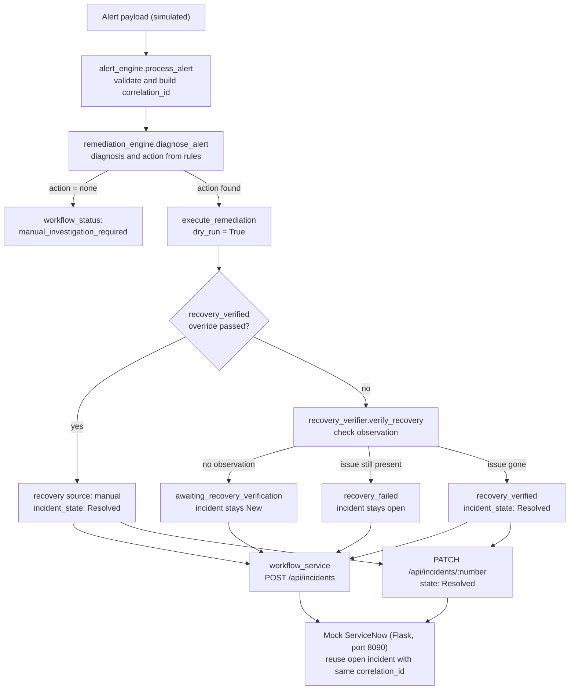

<div align="center">

# 🛡️ Azure Landing Zone Post-Production Automation

### IYAV: a self-healing incident pipeline (proof of concept)

**Monitor → Detect → Correlate → Diagnose → Remediate → Verify → ServiceNow Update**


[](https://github.com/aniket-devop/Azure-Landing-Zone-Post-Production-Automation-/actions/workflows/ci.yml)


[**▶ Watch the demo**](docs/demo/azure_landing_zone_demo.mp4) · [**Quick start**](#-quick-start) · [**How it works**](#-how-it-works) · [**Scenarios**](#-supported-scenarios)

<br>

[](docs/demo/azure_landing_zone_demo.mp4)

</div>

> [!IMPORTANT]
> **Honest scope:** this is a **local proof of concept**. It does not call real Azure or a real ServiceNow. Remediation is **dry-run only** (`resource_changed: false`), recovery observations are **simulated**, and ServiceNow is a **local Flask mock**.

---

## 📌 Table of Contents

[Overview](#-overview) · [Highlights](#-highlights) · [How it works](#-how-it-works) · [Design decisions](#-key-design-decisions) · [Quick start](#-quick-start) · [Run](#-how-to-run) · [Scenarios](#-supported-scenarios) · [Configuration](#-configuration) · [Demo](#-demo-screenshots-and-video) · [Validation](#-validation-evidence) · [Security](#-security-considerations) · [Troubleshooting](#-troubleshooting) · [Limitations](#-limitations) · [Roadmap](#-roadmap) · [Author](#-author)

---

## 🔎 Overview

In post-production cloud operations, the same alert can fire repeatedly, tickets get duplicated, and tickets are sometimes closed before the real problem is fixed.

IYAV models a safer flow. An alert is validated, grouped under a **correlation ID**, diagnosed against a **rule table**, remediated in **dry-run mode**, and then **checked for recovery**. Only after recovery is verified does the ticket move to `Resolved`.

**Objectives**

- Validate alerts and derive a stable correlation ID (hash of resource + rule).
- Diagnose alerts and pick an approved action from one central rule table.
- Verify recovery **before** resolving a ticket.
- Prevent duplicate tickets by reusing an open incident with the same correlation ID.
- Make adding a new scenario a one-entry change in `rules.py`.

## ✨ Highlights

| | |
|---|---|
| 🔁 **End-to-end pipeline** | Seven stages from alert to ServiceNow update, visible live in the dashboard. |
| ✅ **Verify-before-resolve** | The mock ServiceNow returns **HTTP 409** if you try to resolve without verified recovery. |
| 🧩 **Rule-driven** | 10 scenarios defined in one generic rule table. Remediation, approved actions and recovery checks are all derived from it. |
| 🎫 **Duplicate control** | Repeat alerts reuse the open incident; a Resolved one is not reused. |
| 🧪 **Tested** | pytest suite in `tests/` that does not need the mock server. |
| 📊 **Live dashboard** | Trigger *Alert / Recovered / Failed* per scenario and watch results and incidents update. |
| ☁️ **Azure-aware** | Parser for the Azure Monitor Common Alert Schema (sample payloads only) and an Azure Functions `/health` stub. |

## 🧠 How it works

All components run locally. `self_healing_workflow.py` chains the alert engine, remediation engine and recovery verifier. `workflow_service.py` then talks to the mock ServiceNow over HTTP.



| Stage | What happens | Implemented in |
|---|---|---|
| **Monitor / Detect** | Alert payload is received and validated. | `alert_engine.py` |
| **Correlate** | Correlation ID = hash of resource + alert rule. | `alert_engine.py` |
| **Diagnose** | Rule lookup gives a diagnosis and an action. No action means `manual_investigation_required`. | `remediation_engine.py`, `rules.py` |
| **Remediate** | Approved action runs in **dry-run only**. | `remediation_engine.py` |
| **Verify** | (1) manual override, otherwise (2) verifier compares a simulated observation with the rule's check. | `recovery_verifier.py`, `self_healing_workflow.py` |
| **ServiceNow update** | Create or reuse an incident; patch to `Resolved` only if recovery is verified. | `workflow_service.py`, `mock_servicenow.py` |

**Workflow outcomes**

| `workflow_status` | Meaning | Incident |
|---|---|---|
| `manual_investigation_required` | No automated action for this diagnosis. | `New` |
| `awaiting_recovery_verification` | No observation available yet. | `New` |
| `recovery_failed` | Observation shows the issue is still present. | Stays open |
| `recovery_verified` | Manual override or verified observation. | `Resolved` |

**Other components:** `azure_alert_parser.py` parses the Azure Monitor Common Alert Schema (tested against sample payloads only). `function_app.py` is an Azure Functions app with one anonymous `GET /health` route returning `{"project": "IYAV", "status": "healthy", "mode": "foundation"}`; it is not yet connected to the workflow.

## 🎯 Key design decisions

| Decision | Why |
|---|---|
| Dry-run only remediation | Safe to demo and test. No real resource can be changed. |
| Recovery verified before resolve | Prevents tickets being closed while the issue still exists. |
| One central rule table | New scenarios need one entry, not new branching code. |
| Correlation ID from resource + rule | Repeat alerts map to the same incident instead of creating duplicates. |
| Mock ServiceNow enforces the rule too | The safety check holds at the API level as well, not just in the workflow. |

## 🚀 Quick start

```powershell
git clone https://github.com/aniket-devop/Azure-Landing-Zone-Post-Production-Automation-.git
cd Azure-Landing-Zone-Post-Production-Automation-

python -m venv .venv
.venv\Scripts\Activate.ps1          # macOS/Linux: source .venv/bin/activate
pip install -r requirements.txt

python -m pytest -q                 # run the tests
```

**Requirements:** Python 3.9+ (inferred from type hints; not pinned in the repo), pip, Git, a web browser. **No Azure subscription or credentials are needed.**

## ▶️ How to run

**Tests** (no mock server needed)

```bash
python -m pytest -q
```

**Command-line demos** (use two terminals)

```bash
# Terminal 1
python mock_servicenow.py            # mock ServiceNow on port 8090

# Terminal 2
python demo_workflow.py              # single workflow demo
python demo_all_scenarios.py         # 10 scenarios x 3 cases
```

**Live dashboard**

```bash
# Terminal 1
python mock_servicenow.py
# Terminal 2
python dashboard.py
```

Open <http://127.0.0.1:8080>. Pick a scenario and instance, then trigger **Alert**, **Recovered** or **Failed**, or click **Run auto demo**. The same scenario + instance twice reuses the open incident; **Recovered** resolves it.

**Optional: Azure Function health stub** (needs Azure Functions Core Tools)

```bash
func start
# curl http://localhost:7071/api/health   <!-- TODO: confirm route against host.json -->
```

## 🧪 Supported scenarios

All 10 scenarios are **simulated**. Observation fields are invented for this POC (not real Azure metric names) and are supplied in the alert payload.

| # | Scenario | Rule | Recovery check | Status |
|---|---|---|---|---|
| 1 | Disk & Capacity | `Disk-Space-Low` | `disk_free_percent >= 20` | Simulated, in live demo |
| 2 | Application Health | `Application-Health-Failure` | `app_health_status == Healthy` | Simulated |
| 3 | Backup Monitoring | `Backup-Job-Failure` | `last_backup_status == Succeeded` | Simulated |
| 4 | VM Health | `VM-Heartbeat-Lost` | `heartbeat_status == Healthy` | Simulated, workflow tests only |
| 5 | Policy Compliance | `Policy-Tag-Noncompliant` | `compliance_state == Compliant` | Simulated, workflow tests only |
| 6 | Certificate Expiry | `Certificate-Expiring` | `cert_days_to_expiry >= 30` | Simulated, workflow tests only |
| 7 | Network Issues | `Network-DNS-Failure` | `dns_resolution_status == Resolved` | Simulated, workflow tests only |
| 8 | SLA Management | `SLA-Breach-Risk` | `sla_remaining_percent >= 25` | Simulated, workflow tests only |
| 9 | High CPU | `High-CPU-Utilization` | `cpu_percent <= 80` | Simulated, workflow tests only |
| 10 | Service Stopped | `Service-Stopped` | `service_status == Running` | Simulated, workflow tests only |

## ⚙️ Configuration

The current code does **not** read environment variables. Settings are constants:

| Setting | Value | Where |
|---|---|---|
| Mock ServiceNow URL | `http://127.0.0.1:8090` | `SERVICENOW_URL` in `workflow_service.py` |
| Dashboard address | `http://127.0.0.1:8080` | `dashboard.py` |
| HTTP timeout to mock | 5 seconds | `workflow_service.py` |

No secrets or `.env` file are required.

## 🖼️ Demo: screenshots and video

[](docs/demo/azure_landing_zone_demo.mp4)

- In-repo video: [`docs/demo/azure_landing_zone_demo.mp4`](docs/demo/azure_landing_zone_demo.mp4)
- Hosted version (optional): `<ADD YOUTUBE / DRIVE URL HERE>`

**Completed run.** A simulated *Service-Stopped* alert goes through all seven stages. Remediation is shown as `restart_service (dry-run)` and the incident ends `Resolved` with `recovery_verified`.


**Awaiting verification.** A simulated *Disk-Space-Low* alert with no recovery reported yet stays `New` with status `awaiting_recovery_verification`.


## ✅ Validation evidence

**What the project verifies:** alert validation, correlation ID, diagnosis and dry-run remediation; the four recovery paths (verified, failed, no observation, manual override); duplicate-ticket control; the HTTP 409 guard in the mock ServiceNow; and the Azure Monitor schema parser against sample payloads.

**Author-reported results** (from the project's earlier README, not re-executed when writing this one):

| Check | Reported result |
|---|---|
| `python -m pytest -q` | 92 passed at last run |
| `python demo_all_scenarios.py` | 30 cases (10 scenarios × 3 cases), 0 unexpected |

<details>
<summary><b>Paste your latest terminal output here</b></summary>

```text
<PASTE OUTPUT OF: python -m pytest -q>
<PASTE OUTPUT OF: python demo_all_scenarios.py>
```

</details>

The dashboard has no automated test yet. It is demonstrated through the video and screenshots above.

## 🔐 Security considerations

- No credentials or subscription IDs are stored in code.
- Remediation is dry-run only, so no real resource can be modified.
- Recovery cannot be marked verified without an observation or an explicit manual override, and the mock API rejects resolving without it.
- The Azure Function stub uses `AuthLevel.ANONYMOUS`. That is fine for a local stub. Review it before any public deployment.
- The mock ServiceNow and dashboard are for local use (`127.0.0.1`) and have no authentication.
- For real integrations: use environment variables or managed identity, apply least-privilege roles, and keep secrets out of Git.

## 🛠️ Troubleshooting

| Symptom | Likely cause | Fix |
|---|---|---|
| Connection refused on `127.0.0.1:8090` | Mock ServiceNow not running | Start `python mock_servicenow.py` first. |
| Dashboard lacks "Mock ServiceNow connected" | Same as above | Start the mock, then refresh the page. |
| `Address already in use` | Port 8080 or 8090 taken | Stop the other process or change the port. |
| `ModuleNotFoundError` | venv inactive or deps missing | Activate venv, run `pip install -r requirements.txt`. |
| PowerShell blocks `Activate.ps1` | Execution policy | `Set-ExecutionPolicy -Scope Process -ExecutionPolicy RemoteSigned` |
| HTTP 409 on resolve | Recovery not verified | Expected. Send a recovered observation or use the override. |
| Second alert creates no new ticket | Deduplication | Expected. The open incident is reused. |
| Incident stays `New` after "Failed" | Recovery check failed | Expected. Failed recovery leaves it open. |

## ⚠️ Limitations

Not implemented: real Azure integrations (Monitor, Log Analytics, Resource Graph, Policy, Logic Apps, Functions deployment), a real ServiceNow, real remediation and real recovery observations (a provider hook exists, only the simulated one is implemented), work notes and an In-Progress state on failed recovery, SLA timers and real escalation, Terraform/Bicep, and a dashboard test.

## 🗺️ Roadmap

- [ ] Replace the simulated observation provider with real Azure Monitor / Log Analytics queries.
- [ ] Feed live Common Alert Schema payloads into the workflow through the Azure Function.
- [ ] Integrate a real ServiceNow instance with work notes and an In-Progress state.
- [ ] Add real remediation actions behind an approval gate, using managed identity.
- [ ] Move hardcoded settings into environment variables.
- [ ] Add dashboard tests.
- [ ] Add Bicep or Terraform to deploy the Function and supporting resources.

## 📁 Repository structure

```text
.
├── .github/workflows/ci.yml     # Runs pytest on push and pull request
├── docs/
│   ├── demo/                    # Demo video and thumbnail
│   └── screenshots/             # Dashboard screenshots
├── tests/                       # pytest suite
├── rules.py                     # Rule table: one entry per scenario
├── alert_engine.py              # Alert validation, correlation id
├── azure_alert_parser.py        # Azure Monitor Common Alert Schema parser
├── alert_processor.py           <!-- TODO: confirm purpose -->
├── remediation_engine.py        # Diagnosis and dry-run remediation
├── recovery_verifier.py         # Post-remediation recovery check
├── self_healing_workflow.py     # Orchestrates the workflow
├── workflow_service.py          # Create / resolve incidents in mock ServiceNow
├── mock_servicenow.py           # Local Flask mock of ServiceNow
├── demo_workflow.py             # Single-workflow demo
├── demo_all_scenarios.py        # 10 scenarios x 3 cases demo
├── dashboard.py                 # Live dashboard server (port 8080)
├── dashboard_page.html          # Dashboard UI
├── function_app.py              # Azure Functions GET /health stub
├── host.json                    # Azure Functions host configuration
├── requirements.txt             # azure-functions, pytest, Flask, requests
└── LICENSE
```

## 👤 Author

**Aniket Kumar** · [@aniket-devop](https://github.com/aniket-devop)

- LinkedIn: `<ADD URL>`
- Email: `<ADD EMAIL>`
- Acknowledgements: `<ADD MENTORS / COURSE / TOOLS TO CREDIT>`

Licensed under the [MIT License](LICENSE).

---

<div align="center">

*A local proof of concept. All observations are simulated and no real Azure or ServiceNow resources are accessed or modified.*

</div>
