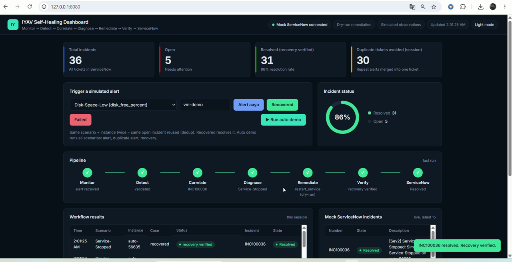
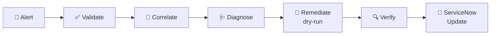
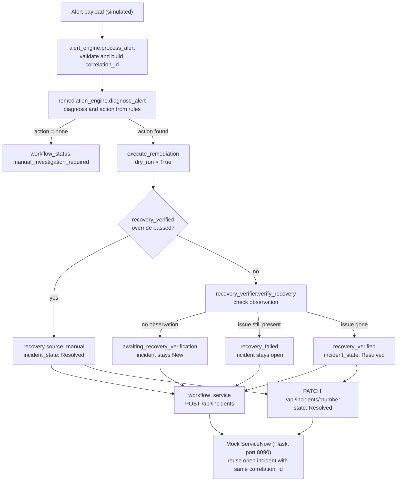
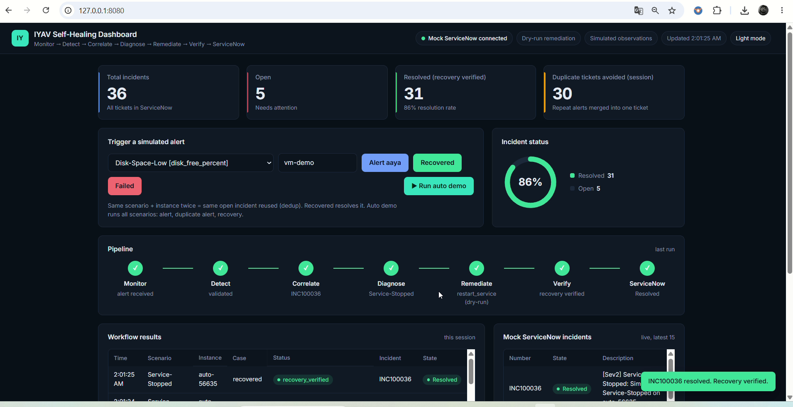
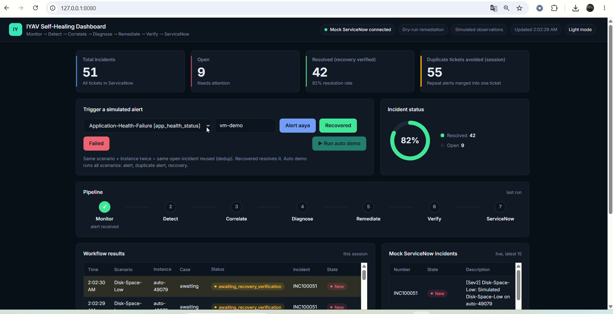

<div align="center">

# 🛡️ IYAV: Self-Healing Automation for Azure Landing Zones

### Post-Production Operations Proof of Concept

**Monitor → Detect → Correlate → Diagnose → Remediate → Verify → ServiceNow Update**


-0A9EDC?logo=pytest&logoColor=white)


[🎬 Demo](#-demo) · [⚡ Quick Start](#-quick-start) · [🧩 Scenarios](#-supported-scenarios) · [🏗️ Architecture](#️-architecture-and-workflow) · [🔐 Security](#-security-considerations)

[](https://github.com/aniket-devop/Azure-Landing-Zone-Post-Production-Automation-/raw/refs/heads/main/docs/demo/azure_landing_zone_demo.mp4)

*▶ Click the thumbnail to watch the live dashboard demo*

</div>

> [!IMPORTANT]
> **This is a local proof of concept (POC).** Nothing in this repository connects to a real Azure subscription or a real ServiceNow instance.
> - Remediation is **dry-run only** (`resource_changed: false`).
> - Recovery observations are **simulated** and are supplied in the alert payload.
> - ServiceNow is replaced by a **local Flask mock**.
>
> There is no Terraform, Bicep, or CI/CD workflow in this repository.

---

## 📑 Table of Contents

1. [Overview](#-overview)
2. [Why IYAV](#-why-iyav)
3. [Problem Statement and Objectives](#-problem-statement-and-objectives)
4. [Architecture and Workflow](#️-architecture-and-workflow)
5. [Technologies Used](#-technologies-used)
6. [Repository Structure](#-repository-structure)
7. [Prerequisites](#-prerequisites)
8. [Quick Start](#-quick-start)
9. [How to Run](#-how-to-run)
10. [Supported Scenarios](#-supported-scenarios)
11. [Configuration](#️-configuration-and-environment-variables)
12. [Demo](#-demo)
13. [Validation Evidence](#-execution-results-and-validation-evidence)
14. [Security Considerations](#-security-considerations)
15. [Troubleshooting](#-troubleshooting)
16. [Current Limitations](#-current-limitations)
17. [Roadmap](#-roadmap)
18. [Author](#-author-and-acknowledgements)

---

## 🔭 Overview

IYAV simulates how a post-production operations process for an Azure Landing Zone could handle common incidents **automatically**.

An alert comes in → the system validates it → groups repeat alerts under one correlation ID → diagnoses the cause → runs a (dry-run) remediation → checks whether the issue has actually cleared → and **only then** resolves the matching incident in a ServiceNow-style ticketing system.



## ✨ Why IYAV

| | Feature | What it means |
|---|---|---|
| 🚫 | **Never resolves on faith** | A ticket moves to `Resolved` only after recovery is verified (or manually overridden). The mock API returns HTTP `409` otherwise. |
| 🔗 | **Stable correlation IDs** | A hash of resource + rule groups repeat alerts under one ID. |
| ♻️ | **Duplicate-ticket control** | An open incident with the same correlation ID is reused; a Resolved one is not. |
| 📋 | **One rule table** | Every scenario lives in `rules.py`. Adding a new one is a single-entry change. |
| 🧪 | **Tested** | Automated pytest suite plus an end-to-end demo of 10 scenarios × 3 cases. |
| 📊 | **Live dashboard** | Watch the pipeline stages and incidents update in real time. |
| 🛟 | **Safe by design** | Dry-run only: no real resource can be modified. |

## 🎯 Problem Statement and Objectives

**Problem.** In post-production cloud operations, the same alert can fire repeatedly, tickets get duplicated, and tickets are sometimes closed before the underlying issue is truly fixed.

**Objectives of this POC**

- ✅ Validate incoming alerts and derive a stable correlation ID (hash of resource + rule).
- ✅ Diagnose alerts and select an approved remediation action from a single rule table.
- ✅ Verify recovery **before** resolving a ticket.
- ✅ Avoid duplicate tickets by reusing an open incident with the same correlation ID.
- ✅ Make adding a new scenario a one-entry change in `rules.py`.
- ✅ Demonstrate the whole flow locally, with automated tests and a live dashboard.

## 🏗️ Architecture and Workflow

All components run locally. The workflow core is `self_healing_workflow.py`, which chains the alert engine, remediation engine, and recovery verifier. `workflow_service.py` then talks to the mock ServiceNow over HTTP.



### How it works, step by step

| Stage | What happens | Implemented in |
|---|---|---|
| **Monitor / Detect** | An alert payload is received and validated. | `alert_engine.py` (`process_alert`) |
| **Correlate** | A correlation ID is derived from a hash of the resource and the alert rule. Alerts for the same resource and rule share one ID. | `alert_engine.py` |
| **Diagnose** | The alert rule is looked up in the rule table to produce a diagnosis and a remediation action. If no action applies, the workflow stops with `manual_investigation_required`. | `remediation_engine.py` (`diagnose_alert`), `rules.py` |
| **Remediate** | The approved action is executed in **dry-run mode only**. No real resource is changed. | `remediation_engine.py` (`execute_remediation`) |
| **Verify** | Recovery is decided in this order: (1) manual override `recovery_verified=True`; (2) otherwise the verifier compares a simulated post-remediation observation with the rule's check. | `recovery_verifier.py`, `self_healing_workflow.py` |
| **ServiceNow update** | An incident is created, or the existing open one with the same correlation ID is reused. If recovery is verified, the incident is patched to `Resolved`. | `workflow_service.py`, `mock_servicenow.py` |

### Possible workflow outcomes

| `workflow_status` | Meaning | Incident state |
|---|---|---|
| `manual_investigation_required` | Diagnosis produced no automated action. | `New` |
| `awaiting_recovery_verification` | No observation available yet. | `New` |
| `recovery_failed` | Observation shows the issue is still present. | Stays open (`New`) |
| `recovery_verified` | Manual override or verified observation. | `Resolved` |

### Supporting components

- **Azure Monitor alert parser:** `azure_alert_parser.py` parses the Azure Monitor **Common Alert Schema**. Tested **against sample payloads only**, not against live Azure.
- **Azure Function stub:** `function_app.py` defines an Azure Functions app with a single anonymous `GET /health` route returning `{"project": "IYAV", "status": "healthy", "mode": "foundation"}`. It is a foundation stub and is **not yet connected to the workflow**.

## 🧰 Technologies Used

| Technology | Usage in this repo |
|---|---|
| 🐍 **Python** | Workflow, rules, engines, demos, dashboard (type hints such as `dict[str, Any]` imply Python 3.9+) |
| 🌶️ **Flask** | Mock ServiceNow API and dashboard server |
| 🌐 **requests** | HTTP client used by `workflow_service.py` to call the mock ServiceNow |
| 🧪 **pytest** | Automated test suite in `tests/` |
| ⚡ **azure-functions** | Azure Functions Python library used by the `function_app.py` health stub |
| 🖥️ **HTML** | Dashboard UI (`dashboard_page.html`) |

Dependencies in `requirements.txt`: `azure-functions`, `pytest`, `Flask`, `requests`.

## 📁 Repository Structure

```text
.
├── README.md
├── LICENSE
├── requirements.txt
├── .gitignore
├── host.json                    # Azure Functions host configuration
├── function_app.py              # Azure Functions app: GET /health stub
│
├── rules.py                     # Rule table: one entry per scenario
├── alert_engine.py              # Alert validation, correlation id
├── azure_alert_parser.py        # Azure Monitor Common Alert Schema parser
├── alert_processor.py           <!-- TODO: confirm purpose and update this comment -->
├── remediation_engine.py        # Diagnosis and dry-run remediation
├── recovery_verifier.py         # Post-remediation recovery check
├── self_healing_workflow.py     # Orchestrates the workflow
├── workflow_service.py          # Calls mock ServiceNow (create / resolve incident)
├── mock_servicenow.py           # Local Flask mock of ServiceNow
│
├── demo_workflow.py             # Demo against the mock server
├── demo_all_scenarios.py        # 10 scenarios x 3 cases end-to-end demo
├── dashboard.py                 # Live dashboard server (port 8080)
├── dashboard_page.html          # Dashboard UI
│
├── tests/                       # pytest suite
└── docs/
    ├── demo/                    # Demo video and thumbnail
    └── screenshots/             # Dashboard screenshots
```

## 📋 Prerequisites

- **Python 3.9 or newer** (the version is not pinned in the repository)
- **pip**
- **Git**
- A modern web browser for the dashboard

> ☁️ **Azure setup: none required.** This POC does not call Azure. No subscription, Azure CLI, or credentials are needed.

**Optional:** [Azure Functions Core Tools](https://learn.microsoft.com/azure/azure-functions/functions-run-local) to run the `/health` stub locally with `func start`.

## ⚡ Quick Start

```bash
# 1. Clone the repository
git clone https://github.com/aniket-devop/Azure-Landing-Zone-Post-Production-Automation-.git
cd Azure-Landing-Zone-Post-Production-Automation-

# 2. Create and activate a virtual environment
python -m venv .venv

# Windows (PowerShell)
.venv\Scripts\Activate.ps1
# macOS / Linux
source .venv/bin/activate

# 3. Install dependencies
pip install -r requirements.txt

# 4. Run the tests (no mock server needed)
python -m pytest -q
```

No secrets or `.env` file are needed.

## ▶️ How to Run

### 🧪 1. Run the automated tests

The tests **do not** need the mock server.

```bash
python -m pytest -q
```

### 💻 2. Run the command-line demos

Each demo needs the mock ServiceNow running, so use **two terminals**.

| Terminal | Command | Purpose |
|---|---|---|
| **1** | `python mock_servicenow.py` | Starts mock ServiceNow on port 8090 |
| **2** | `python demo_workflow.py` | Single-workflow demo |
| **2** | `python demo_all_scenarios.py` | All 10 scenarios × 3 cases (awaiting, recovered, failed) |

### 📊 3. Run the live dashboard

| Terminal | Command |
|---|---|
| **1** | `python mock_servicenow.py` |
| **2** | `python dashboard.py` |

Then open **<http://127.0.0.1:8080>**.

In the dashboard you can:

1. Pick a **scenario** and enter an **instance** name.
2. Trigger **Alert**, **Recovered**, or **Failed**.
3. Optionally click **Run auto demo** to run through all scenarios.
4. Watch the **pipeline** stages, the **workflow results** table, and the **live mock ServiceNow incidents**.

**Expected behavior:** the same scenario + instance triggered twice **reuses the open incident** (deduplication); **Recovered** resolves it; **Failed** leaves it open.

### ⚡ 4. (Optional) Run the Azure Function health stub

```bash
func start
# then call the health route; the default route prefix is /api
# curl http://localhost:7071/api/health   <!-- TODO: confirm against host.json -->
```

## 🧩 Supported Scenarios

There are **10 scenarios**, all **simulated**. "Simulated" means the observation fields are invented for this POC (they are **not** real Azure metric names) and the observations are supplied in the alert payload. No real resource is checked or changed.

| # | Scenario | Rule | Recovery check | Status |
|---|---|---|---|---|
| 1 | 💾 Disk & Capacity | `Disk-Space-Low` | `disk_free_percent >= 20` | Simulated, in live demo |
| 2 | 🩺 Application Health | `Application-Health-Failure` | `app_health_status == Healthy` | Simulated |
| 3 | 🗄️ Backup Monitoring | `Backup-Job-Failure` | `last_backup_status == Succeeded` | Simulated |
| 4 | 🖥️ VM Health | `VM-Heartbeat-Lost` | `heartbeat_status == Healthy` | Simulated, workflow tests only |
| 5 | 📜 Policy Compliance | `Policy-Tag-Noncompliant` | `compliance_state == Compliant` | Simulated, workflow tests only |
| 6 | 🔐 Certificate Expiry | `Certificate-Expiring` | `cert_days_to_expiry >= 30` | Simulated, workflow tests only |
| 7 | 🌐 Network Issues | `Network-DNS-Failure` | `dns_resolution_status == Resolved` | Simulated, workflow tests only |
| 8 | ⏱️ SLA Management | `SLA-Breach-Risk` | `sla_remaining_percent >= 25` | Simulated, workflow tests only |
| 9 | 🔥 High CPU | `High-CPU-Utilization` | `cpu_percent <= 80` | Simulated, workflow tests only |
| 10 | 🛑 Service Stopped | `Service-Stopped` | `service_status == Running` | Simulated, workflow tests only |

> 💡 **Adding a scenario:** remediation, approved actions, and recovery checks are all derived from the generic rule table in `rules.py`, so adding a scenario means adding **one entry** there.

## ⚙️ Configuration and Environment Variables

The current code **does not read any environment variables**. Settings are constants or defaults:

| Setting | Value | Where |
|---|---|---|
| Mock ServiceNow base URL | `http://127.0.0.1:8090` | `SERVICENOW_URL` constant in `workflow_service.py` |
| Dashboard address | `http://127.0.0.1:8080` | `dashboard.py` |
| HTTP timeout to mock ServiceNow | 5 seconds | `workflow_service.py` |

To point the workflow at a different mock server, edit `SERVICENOW_URL` in `workflow_service.py`.

> Real integrations (Azure, ServiceNow) are not implemented. If you add them later, read credentials from environment variables or use managed identity, and never commit them.

## 🎬 Demo

### Video demonstration

A screen recording of the live dashboard is included in this repository.

- 📹 **In-repo video:** [`docs/demo/azure_landing_zone_demo.mp4`](https://github.com/aniket-devop/Azure-Landing-Zone-Post-Production-Automation-/raw/refs/heads/main/docs/demo/azure_landing_zone_demo.mp4)
- 🌍 **Hosted version (optional):** `<ADD YOUTUBE / DRIVE / RELEASE URL HERE>`

### Screenshots

Both screenshots are taken from the demo recording and show the dashboard at `http://127.0.0.1:8080`.

**✅ Completed pipeline: `Service-Stopped` resolved**



> A simulated **Service-Stopped** run: all seven pipeline stages complete, the remediation is shown as `restart_service (dry-run)`, and the incident ends as **Resolved** with `recovery_verified`.

**⏳ Awaiting verification: `Disk-Space-Low`**



> A simulated **Disk-Space-Low** alert for which recovery has not yet been reported: status `awaiting_recovery_verification`, incident state **New**.

## ✅ Execution Results and Validation Evidence

### What the project verifies

- ✔️ Alert validation, correlation ID generation, diagnosis, and dry-run remediation.
- ✔️ Recovery verification before resolve, covering four paths: verified (Resolved), failed (incident stays New), no observation (awaiting verification), and manual override.
- ✔️ Duplicate-ticket control: an open incident with the same correlation ID is reused; a Resolved one is not.
- ✔️ The mock ServiceNow refuses to Resolve without verified recovery (HTTP `409`).
- ✔️ Azure Monitor Common Alert Schema parsing, against sample payloads only.

### Author-reported results

| Check | Reported result |
|---|---|
| `python -m pytest -q` | **92 passed** at last run |
| `python demo_all_scenarios.py` | **30 cases** (10 scenarios × 3 cases), **0 unexpected** |

> [!NOTE]
> These figures were reported by the author and were **not re-executed while preparing this README**.

**Not covered by automated tests:** the dashboard has no automated test yet; it is demonstrated through the video and screenshots above.

## 🔐 Security Considerations

- 🔑 No credentials or subscription IDs are stored in the code.
- 🧯 Remediation is dry-run only, so no real resource can be modified by this POC.
- 🚦 Recovery cannot be marked verified without either an observation or an explicit manual override, and the mock ServiceNow rejects resolving without verified recovery.
- ⚠️ The Azure Function stub uses `AuthLevel.ANONYMOUS`. This is acceptable for a local health stub only. **Do not deploy it publicly without reviewing the auth level.**
- 🏠 The mock ServiceNow and dashboard are intended for local use (`127.0.0.1`) and have no authentication.
- 🛡️ Before any real integration: use environment variables or managed identity, keep secrets out of Git, and apply least-privilege roles to any remediation identity.

## 🛠️ Troubleshooting

<details>
<summary><b>Click to expand the troubleshooting table</b></summary>

| Symptom | Likely cause | What to do |
|---|---|---|
| `ConnectionError` / connection refused on `127.0.0.1:8090` | Mock ServiceNow is not running | Start `python mock_servicenow.py` first, in its own terminal. |
| Dashboard does not show "Mock ServiceNow connected" | Same as above | Start the mock server, then refresh `http://127.0.0.1:8080`. |
| `Address already in use` | Port 8080 or 8090 is taken | Stop the other process, or change the port in the relevant script. |
| `ModuleNotFoundError` | Dependencies not installed or venv not active | Activate the venv and run `pip install -r requirements.txt`. |
| PowerShell blocks `Activate.ps1` | Execution policy | Run `Set-ExecutionPolicy -Scope Process -ExecutionPolicy RemoteSigned`, then activate again. |
| HTTP `409` when resolving an incident | Recovery was not verified | Expected behavior. Send a recovered observation, or use the manual override. |
| A second alert does not create a new ticket | Deduplication | Expected. An open incident with the same correlation ID is reused. |
| Incident stays `New` after a "Failed" run | Recovery check failed | Expected. Failed recovery leaves the incident open. |
| Tests fail unexpectedly | Environment mismatch | Confirm Python 3.9+ and a fresh `pip install -r requirements.txt`. The tests do not need the mock server. |

</details>

## 🚧 Current Limitations

**Not implemented:**

- ❌ Real Azure: Monitor, Log Analytics, Resource Graph, Policy, Logic Apps, and Functions deployment.
- ❌ Real ServiceNow (a local Flask mock is used instead).
- ❌ Real remediation and real recovery observations. A provider hook exists, but only the simulated provider is implemented.
- ❌ Work notes and an In-Progress state on failed recovery.
- ❌ SLA timers and real escalation. The SLA scenario only checks a simulated percentage.
- ❌ Terraform / Bicep infrastructure code and CI/CD workflows.
- ❌ An automated test for the dashboard.

## 🗺️ Roadmap

Ideas that follow naturally from the current design (none are implemented yet):

- [ ] Replace the simulated observation provider with real Azure Monitor / Log Analytics queries through the existing provider hook.
- [ ] Feed live Azure Monitor Common Alert Schema payloads into the workflow via the Azure Function.
- [ ] Integrate with a real ServiceNow instance, including work notes and an In-Progress state on failed recovery.
- [ ] Add real remediation actions behind an approval gate, authenticated with managed identity.
- [ ] Move hardcoded settings (such as `SERVICENOW_URL`) into environment variables.
- [ ] Add tests for the dashboard and a GitHub Actions workflow that runs `pytest` on every push.
- [ ] Add Infrastructure as Code (Bicep or Terraform) for deploying the Function and supporting resources.

## 👤 Author and Acknowledgements

**Aniket Kumar** · DevSecOps Engineer

[](https://github.com/aniket-devop)
[](https://linkedin.com/in/aniket484)
[](mailto:aniketkmr484@gmail.com)

🙏 Thanks to the mentors, learning resources, and open-source tools that supported this project.

📄 Licensed under the [MIT License](https://github.com/aniket-devop/Azure-Landing-Zone-Post-Production-Automation-/blob/main/LICENSE).

---

<div align="center">

*This README describes a local proof of concept. All observations are simulated, and no real Azure or ServiceNow resources are accessed or modified.*

⭐ If you found this useful, consider starring the repo!

</div>
